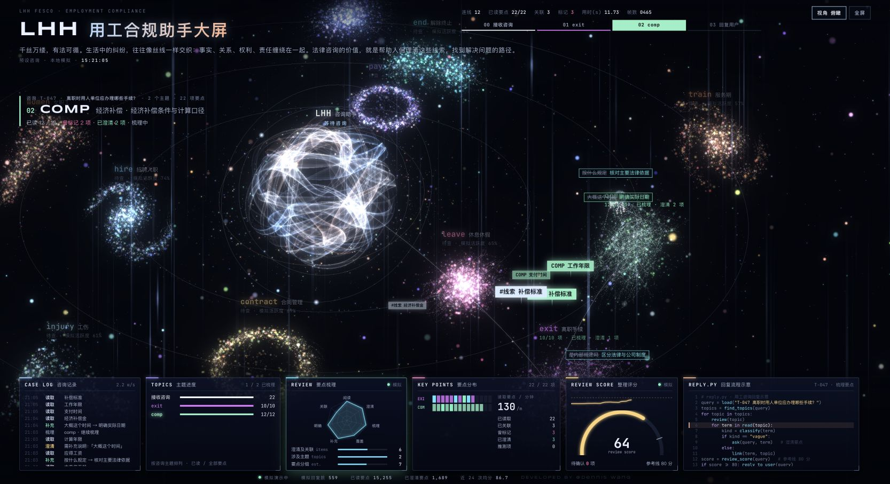

# LHH用工合规助手大屏

把用工咨询的梳理过程，展示为一只星云蜘蛛在 12 类用工主题之间跳跃、读词、连线、澄清并汇总回复的 3D 大屏。

**千丝万缕，有法可循。**

- [在线访问](https://lemomnblues.github.io/lhh-agent-display/)
- [项目仓库](https://github.com/Lemomnblues/lhh-agent-display)



## 项目内容

- 12 类用工主题：招聘入职、工资工时、休息休假、女职工、解除终止、经济补偿、合同管理、保密竞业、服务期、离职手续、工伤、争议解决。
- 32 条预设咨询，自动演示“接收咨询 → 定位主题 → 梳理要点 → 汇总要点 → 回复用户”。
- 粒子星云、丝带星核、八足蜘蛛与跳跃连线动画。
- 六个信息面板：咨询记录、主题进度、信息雷达、关键词热度、整理评分、回复代码示意。
- 俯瞰、斜视、跟随、环绕视角，支持拖动旋转、滚轮缩放、点击星云聚焦和全屏展示。

当前版本为预设数据的前端模拟演示，未接入 LHH 业务接口、真实咨询数据或法律知识检索。页面计数、评分、日志及代码均用于展示流程。

## 访问与运行

直接打开 [在线大屏](https://lemomnblues.github.io/lhh-agent-display/)，无需安装。

本地运行：

```bash
git clone https://github.com/Lemomnblues/lhh-agent-display.git
cd lhh-agent-display
python3 -m http.server 8000
```

访问 <http://localhost:8000/>。也可以在下载后直接用现代浏览器打开 `index.html`。依赖和字体均随仓库提供，无需构建或安装 npm 包。

建议使用支持 WebGL 的 Chrome 或 Edge，采用 16:9 横屏展示。点击右上角“视角”切换镜头；按 `V` 也可切换；点击星云聚焦，再次点击返回；按 `Esc` 退出聚焦。

## 技术与结构

HTML / CSS / 原生 JavaScript、Three.js、WebGL、Canvas 2D、Shadow DOM。

```text
index.html       大屏页面、预设咨询与动画逻辑
vendor/three/    Three.js 与 Bloom 后处理依赖
vendor/fonts/    本地字体与许可证
docs/preview.jpg 页面实拍预览
LICENSE         PolyForm Noncommercial 1.0.0
NOTICE          来源及版权说明
```

## 来源与许可

基于 [cyberdaddyleo/agent-display](https://github.com/cyberdaddyleo/agent-display/tree/ff44824a741d9b2a767b82f39d3dd34c75c87e3f) 的可视化版本进行 LHH 场景改编，保留上游版权声明与依赖许可。

项目按 [PolyForm Noncommercial License 1.0.0](LICENSE) 分发。非商业用途可按许可使用；商业使用需另行获得授权。详情见 [NOTICE](NOTICE) 及上游项目。
